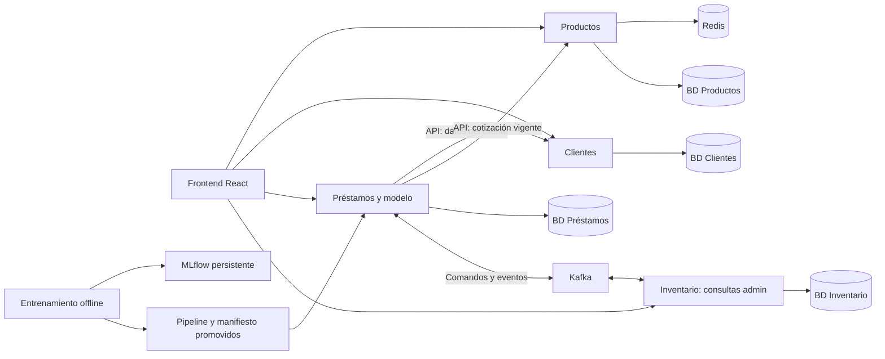
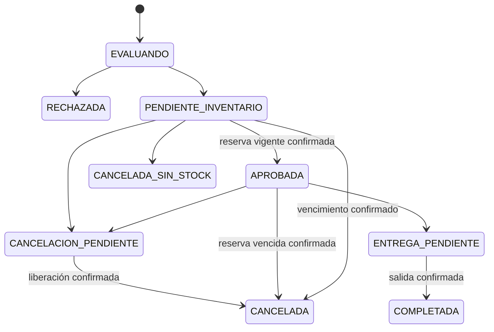

# Plan de implementación de CrediMarket

Fecha: 18 de octubre de 2026. Estado: propuesta de implementación basada en la lectura del enunciado y el análisis directo de los dos CSV. No se ha implementado ni entrenado el sistema.

Actualización: la fase 1 de diseño está documentada en [docs/FASE_1.md](docs/FASE_1.md). Sus contratos y decisiones concretas prevalecen sobre las propuestas iniciales de este análisis. La numeración vigente es la de [desarrollo por etapas](PLAN_DESARROLLO_POR_ETAPAS.md); el siguiente paso es la etapa 2, infraestructura.

## 1. Objetivo y alcance

Construir un sistema académico reproducible que permita solicitar financiación desde el navegador, evaluar riesgo con un modelo trazable y reservar inventario sin sobreventa, incluso con concurrencia, mensajes duplicados y reinicios.

El alcance incluye exactamente cuatro microservicios de negocio: Productos, Clientes, Préstamos e Inventario. Entrenamiento fuera de línea y modelo servido dentro de Préstamos. Frontend, PostgreSQL, Kafka, Redis y MLflow son infraestructura o componentes auxiliares, no servicios de negocio adicionales.

Priorizar todos los requisitos evaluados antes de extensiones. No incluir inicialmente Kubernetes, nube paga, pagos reales, notificaciones externas, un servicio independiente de ML ni dashboards complejos.

**Ambigüedades resueltas para planificar:**

- Autenticación y roles aparecen como opcionales en las secciones 9 y 10, pero obligatorios en la sección 11, la prueba 13 y la rúbrica. Se implementarán y probarán.
- Se anuncian etapas MLOps A–F, pero el desarrollo del documento llega hasta E. Se tratarán monitoreo, drift simulado, segunda versión y rollback como etapa F, porque la rúbrica los exige. Esta es una interpretación explícita para cubrir la evaluación.
- No se proporciona fecha calendario de entrega. El cronograma usa jornadas relativas y deberá ajustarse a la disponibilidad del equipo.
- El enunciado menciona un diccionario de datos; entre los tres archivos no hay uno separado. Se elaborará uno, distinguiendo unidades observadas y reglas propuestas.

## 2. Resultados del análisis de datos

| Propiedad | Histórico | Solicitudes nuevas |
|---|---:|---:|
| Filas | 12.000 | 200 |
| Columnas | 15 | 14 |
| Identificadores de cliente distintos | 12.000 | 200 |
| Filas completas duplicadas | 0 | 0 |
| Objetivo `incumplimiento_90d` | Presente | Ausente |
| Faltantes en `tipo_empleo` | 93 | 2 |
| Faltantes en `antiguedad_laboral_meses` | 91 | 1 |
| Faltantes en `meses_historial_crediticio` | 97 | 1 |
| Faltantes en `porcentaje_pago_puntual` | 2.473 | 43 |

No hay clientes compartidos entre ambos archivos. Los faltantes de porcentaje puntual coinciden exactamente con `creditos_previos = 0`; no significan pago puntual de cero. Las otras columnas no presentan celdas vacías en esta inspección.

El histórico contiene 3.667 incumplimientos (30,56 %) y 8.333 no incumplimientos (69,44 %). No basta evaluar accuracy: un predictor constante de no incumplimiento tendría 69,44 % sin identificar ningún incumplimiento.

Observaciones verificadas:

- Ingresos históricos: COP 1.400.000–28.000.000; montos: COP 500.000–15.000.000.
- Plazos presentes: 6, 12, 18, 24 y 36 meses.
- Empleo: dependiente, independiente, temporal o vacío.
- Tasa mensual: constante de 0,018 en ambos archivos.
- La cuota coincide con la fórmula de anualidad `monto * tasa / (1 - (1 + tasa)^(-plazo))`, con diferencia menor a COP 0,005 por redondeo.
- No existen producto, precio unitario, cantidad, stock, contraseña ni rol en los CSV. Estos datos necesitan migraciones y datos iniciales propios.

Hashes SHA-256 de los archivos originales:

```text
prestamos_entrenamiento.csv
c6cdc437c3aecc9116bc8b978df421d5a7600634c1ad7d6f82e58222a2446ecd

solicitudes_nuevas.csv
1430d7b34e924d5e4170c4fb9d9a412c1000af17c062af513ef15e44a1a7f1f7
```

Conservar originales sin modificaciones. El EDA reproducible agregará percentiles, distribuciones, relaciones entre variables, validaciones semánticas y visualizaciones; la inspección actual no constituye un entrenamiento ni una certificación exhaustiva de calidad.

## 3. Arquitectura propuesta

| Componente | Elección propuesta | Motivo dentro del proyecto |
|---|---|---|
| Servicios | Python + FastAPI + Pydantic | Un lenguaje backend y contratos de entrada explícitos |
| Persistencia | PostgreSQL, SQLAlchemy y Alembic | Transacciones, restricciones y migraciones por servicio |
| Mensajería | Kafka | Flujo acotado de comandos y respuestas entre dos dominios |
| Caché | Redis | Cache-aside verificable en Productos |
| ML | pandas, scikit-learn, joblib, MLflow | Pipeline completo, comparación y trazabilidad |
| Frontend | React + TypeScript + Vite | Formularios, seguimiento y vistas por rol |
| Pruebas | pytest y Playwright | Integración real y flujo de navegador |
| Ejecución | Docker Compose | Reproducción local con volúmenes persistentes |

Las versiones exactas se fijarán después de comprobar compatibilidad en la primera fase, con archivos de bloqueo e imágenes versionadas; entrenamiento y servicio usarán las mismas versiones de las dependencias del pipeline.



Una instancia PostgreSQL tendrá cuatro bases lógicas y usuarios exclusivos; MLflow tendrá almacenamiento separado. Ningún servicio consultará tablas ajenas ni tendrá credenciales que lo permitan. Los identificadores externos son referencias, sin claves foráneas entre bases.

El frontend puede servirse con un proxy de rutas API dentro de su contenedor. Ese proxy no incorpora reglas de negocio. Los workers pertenecen a Préstamos e Inventario, reutilizan su código y pueden tener procesos propios; no constituyen un quinto dominio.

## 4. Responsabilidades, persistencia y APIs

| Servicio | Tablas principales | Operaciones previstas |
|---|---|---|
| Productos | productos: precio decimal, categoría, activo, versión | Crear, listar, consultar, editar, desactivar; cotización interna desde PostgreSQL |
| Clientes | clientes, usuarios, importaciones | Registro, consulta, edición autorizada, importación CSV, sesión |
| Préstamos | prestamos, historial_estados, idempotencia_http, outbox, inbox | Crear/consultar/listar propios, cancelar, solicitar entrega, inferencia, información del modelo |
| Inventario | existencias, reservas, movimientos, outbox, inbox | Consultar existencias/reservas/movimientos, registrar entradas; consumir reserva, liberación y entrega |

Préstamos conservará cliente y producto referenciados, cantidad, precio unitario y versión cotizada, monto, plazo, cuota, características utilizadas, probabilidad, umbral, versión del modelo, run ID, motivo y marcas de tiempo. Esto permite explicar una decisión aunque después cambien los datos del cliente, el precio o el modelo.

Contratos REST iniciales:

- Productos: `GET/POST /productos`, `GET/PATCH /productos/{id}`, `POST /productos/{id}/desactivar`, `GET /interno/productos/{id}/cotizacion`.
- Clientes: `POST /auth/login`, `POST /clientes`, `GET/PATCH /clientes/{id}`, `POST /clientes/importaciones`, `GET /clientes/importaciones/{id}`.
- Préstamos: `POST /prestamos`, `GET /prestamos`, `GET /prestamos/{id}`, `POST /prestamos/{id}/cancelacion`, `POST /prestamos/{id}/entrega`.
- Préstamos, obligatorios: `POST /riesgo/predict`, `GET /modelo/info`, `GET /health`, `GET /ready`.
- Inventario: `GET /inventario`, `GET /inventario/reservas`, `GET /inventario/movimientos`, `POST /inventario/entradas`.

El endpoint de entrega pertenece al coordinador Préstamos, está restringido al administrador y emite un comando; Inventario confirma físicamente la salida. El navegador no modifica reservas directamente.

`POST /prestamos` recibe producto, cantidad y plazo; para clientes ordinarios la identidad se deriva del token. El precio y el monto enviados arbitrariamente se rechazan. Una solicitud favorable duraderamente aceptada devuelve 202, identificador y URL de consulta; un rechazo de negocio persistido devuelve 201 con estado RECHAZADA. Entradas inválidas: 422; conflicto de idempotencia: 409; identidad ausente: 401; permisos insuficientes: 403 o 404 según el contrato de privacidad.

Cada servicio expondrá health y ready. En Préstamos, falta de artefacto, hash inválido o BD inaccesible implica ready 503. La caída temporal del broker se informará como degradación: mientras la BD y el outbox funcionen se puede aceptar trabajo pendiente, sujeto a un límite de backlog documentado. El proceso no aparentará estar listo para inferencia sin modelo.

## 5. Flujo, concurrencia y recuperación

1. Autenticar, validar y reclamar la clave de idempotencia mediante restricción única por usuario y operación; guardar hash canónico del contenido.
2. Consultar Clientes y cotización vigente en Productos con timeouts acotados. Completar la evaluación fuera de una transacción prolongada; recuperar solicitudes en preparación si el proceso cae.
3. Calcular monto y cuota con aritmética decimal, construir características y evaluar el pipeline cargado.
4. Persistir rechazo o, en una única transacción local, estado pendiente y comando en outbox. Solo responder aceptación cuando la transacción esté confirmada.
5. Publicar desde el outbox con acks=all y confirmación de entrega del productor; marcar enviado después de confirmación. La republicación tras un fallo es válida.
6. Inventario registra el mensaje, reserva y genera su evento de respuesta en una sola transacción. Confirma el offset después del commit de PostgreSQL.
7. Préstamos consume la respuesta y actualiza el estado con deduplicación durable.

La idempotencia HTTP devolverá el mismo identificador y la respuesta de creación almacenada para la misma clave/contenido; GET mostrará el estado actual. Una clave reutilizada con otro cuerpo devuelve 409. Peticiones simultáneas no pueden crear dos préstamos. Definir recuperación de una clave reclamada cuyo proceso cae antes de completar la respuesta.

Reserva atómica propuesta: `UPDATE existencias SET reservado = reservado + :cantidad WHERE producto_id = :id AND fisico - reservado >= :cantidad RETURNING ...`. La reserva y el movimiento se insertan en la misma transacción. Restricciones: `fisico >= 0`, `reservado >= 0`, `reservado <= fisico` y una reserva de negocio por préstamo. Al entregar disminuyen físico y reservado; al cancelar solo reservado. Bloquear la reserva al competir entrega, cancelación y vencimiento.



El diagrama resume el flujo principal; la implementación agregará una tabla exhaustiva de transiciones, duplicados y eventos incompatibles. EVALUANDO es un estado técnico recuperable. Un fallo de infraestructura no se registra como rechazo crediticio. Los estados finales no se reactivan.

Casos que deben diseñarse antes del frontend:

- **Cancelar antes de reservar:** Inventario persiste una marca de cancelación por préstamo aunque todavía no exista reserva. Si llega después ReservaSolicitada, no reserva. Solo finalizar CANCELADA después de confirmación de Inventario.
- **Confirmación tardía:** no transforma una cancelación pendiente o final en APROBADA; solicitar liberación idempotente si procede.
- **Vencimiento:** un worker de Inventario libera transaccionalmente y emite ReservaExpirada con outbox. Préstamos termina CANCELADA con motivo RESERVA_VENCIDA. Guardar fecha de expiración para no presentar una aprobación como utilizable cuando ya caducó aunque el evento esté retrasado.
- **Entrega frente a vencimiento:** Inventario arbitra bajo bloqueo. Si venció, rechaza la entrega y publica el resultado para cerrar el estado pendiente coherentemente.
- **Entrega frente a cancelación:** el coordinador acepta una sola operación incompatible mediante comparación de estado; Inventario también valida. Nunca liberar una salida ya completada.
- **Desorden de eventos:** usar identidad y estado de reserva, secuencia o versión de agregado y guardas; un InventarioReservado antiguo no vence a ReservaExpirada ya procesado.
- **Timeout:** no equivale a falta de stock ni habilita cancelar sin liberar. Un reconciliador reintenta o consulta por API interna; si no puede confirmar, conserva un estado pendiente visible.

Valores iniciales configurables para la demo: timeout HTTP interno 2 s, dos reintentos solo para lecturas seguras; alerta de pendiente a 60 s; reserva 10 min; barrido de vencimiento cada 5 s; polling del frontend cada 2 s con retroceso al fallar. Son decisiones propuestas, no valores exigidos por el documento.

## 6. Kafka y contratos

**Qué se hace:** transportar comandos y resultados reales entre Préstamos e Inventario.

| Elemento | Configuración inicial propuesta |
|---|---|
| Despliegue local | Un nodo KRaft persistente; sin alta disponibilidad |
| Topic de comandos | `credimarket.inventario.comandos.v1` |
| Topic de resultados | `credimarket.inventario.eventos.v1` |
| Particiones y retención | Tres por topic; siete días de retención |
| Clave | `prestamo_id` |
| Grupos | `inventario-v1` y `prestamos-v1` |
| Productor | Idempotencia habilitada y `acks=all` |
| Consumidor | Confirmación manual de offsets después de persistir |
| Fallos permanentes | Topics `.dlq`, retención inicial de 14 días |

- Implementar transactional outbox en ambos servicios: guardar cambios y publicación pendiente en una misma transacción.
- Publicar y marcar enviado únicamente después de recibir confirmación del productor.
- Guardar event_id procesado y efecto en una misma transacción local mediante inbox.
- Procesar secuencialmente dentro de cada partición; no confirmar offsets que cubran registros aún sin terminar.
- Manejar reinicios y rebalanceos. Definir reintentos de aplicación con contador durable, pausas de 5/15/60 s y polling activo; distinguirlos de los reintentos del cliente Kafka.
- Al agotar reintentos, persistir fallo y outbox de DLQ antes de avanzar el offset; el publicador completa el envío durablemente.
- Preparar inspección de mensajes, lag, reenvío autorizado desde DLQ y replay diagnóstico sin efectos de negocio.

El orden por partición no sustituye la reserva atómica: dos préstamos del mismo producto pueden ir a particiones distintas. Tampoco hay atomicidad automática entre Kafka y PostgreSQL; por eso se conservan outbox, inbox y restricciones de negocio. Referencia: [diseño de Kafka](https://kafka.apache.org/41/design/design/).

**Entregables:** productores, consumidores, creación de topics, outbox/inbox, reintentos y DLQ.

**Se termina cuando:** una reserva real viaja por Kafka y devuelve un resultado; reiniciar un consumidor o duplicar el mensaje no duplica el efecto. Esta etapa usa comandos de prueba de integración, sin presentar todavía una aprobación de crédito completa.

Plan operativo vigente: [PLAN_DESARROLLO_POR_ETAPAS.md](PLAN_DESARROLLO_POR_ETAPAS.md). Sus etapas reemplazan el cronograma inicial de la sección 12.

## 7. Redis y precio correcto

Usar cache-aside por producto con clave `productos:v1:{id}` y TTL inicial de 60 s. Registrar hit, miss, error y latencia. Después del commit de edición/desactivación, invalidar la entrada; registrar y reintentar invalidaciones fallidas. Redis caído: timeout de 100 ms y lectura de PostgreSQL, con circuito temporal para evitar sumar el timeout en todas las consultas.

Documentar la carrera en la que una lectura antigua repuebla la caché después de invalidar: puede existir desactualización hasta el TTL. La cotización interna lee directamente la fuente de verdad y valida producto activo; así la compra nunca depende de ese precio obsoleto. Se conserva la versión observada al cotizar, no se promete congelar el catálogo durante toda la solicitud.

Pruebas: miss, hit, expiración, cambio de precio, desactivación, caída y recuperación. Medir p50/p95, tasa de aciertos y CPU/memoria con cargas iguales y calentamiento explícito; no prometer mejoras antes de medir. Idempotencia y reservas nunca dependen de Redis.

## 8. Plan de ML y MLOps

### A. Preparación y contrato de características

Generar un reporte reproducible, diccionario, hash y manifiesto de particiones. Separar 7.200/2.400/2.400 filas con estratificación y semilla fija 42, conservando los identificadores de cada conjunto.

Excluir de predictores solicitud_id, cliente_id y etiqueta. Excluir tasa constante del estimador, pero conservarla como parámetro de cálculo y trazabilidad. Empezar con las otras 11 variables originales; justificar conservar cuota como transformación de monto/plazo útil para modelos lineales y comparar redundancia sin consultar prueba. Cualquier característica derivada debe calcularse con la misma función en entrenamiento e inferencia.

Numéricas: imputación de mediana y señal de faltante; estandarización para regresión logística. Empleo: categoría explícita de dato ausente y one-hot. Porcentaje puntual sin historial: imputación acompañada de indicador; no imputar como cero sin explicación. Aprender transformaciones únicamente con entrenamiento dentro de Pipeline/ColumnTransformer, conforme a las recomendaciones sobre fuga de datos de [scikit-learn](https://scikit-learn.org/stable/common_pitfalls.html).

Validar ingresos positivos, montos positivos y límites de la política sintética, cantidades enteras positivas, plazos admitidos, conteos no negativos y porcentaje entre 0 y 100. Los mínimos/máximos observados no se convierten automáticamente en leyes del dominio. Rechazar categorías desconocidas o definir explícitamente su tratamiento. Aceptar solo los faltantes permitidos por el contrato.

### B. Experimentos y selección

Registrar un baseline DummyClassifier y seis candidatos como mínimo:

| Algoritmo | Configuración 1 propuesta | Configuración 2 propuesta |
|---|---|---|
| Regresión logística | C=0,1 | C=1 |
| Árbol de decisión | profundidad=4, mínimo hoja=20 | profundidad=8, mínimo hoja=20 |
| Random forest | 200 árboles, profundidad=8 | 200 árboles, profundidad sin límite, mínimo hoja=5 |

Definir antes de ejecutar: mayor AP de validación como criterio principal; dentro de una tolerancia fijada de 0,005, menor Brier y luego menor complejidad/latencia. No anticipar cuál ganará.

Registrar precision, recall y F1 de clase 1, ROC-AUC, AP, matriz de confusión, Brier y curva de calibración. Si se recalibra, ajustar con particiones internas de entrenamiento, no con prueba.

Seleccionar el umbral sobre validación con costos ficticios explícitos: por ejemplo, costo 5 al aprobar un incumplimiento y 1 al rechazar un pagador. Mostrar curva de costo y sensibilidad. Riesgo favorable cuando probabilidad < umbral; esto todavía no aprueba inventario. Congelar pipeline y umbral antes de la evaluación final de prueba.

### C. MLflow persistente

Guardar algoritmo, parámetros, semilla, particiones, hashes, variables, commit, dependencias, duración y métricas diferenciadas por conjunto. Artefactos: pipeline, matrices, curvas, evaluación y ejemplo. Mantener historial navegable con backend y artefactos persistentes; la captura es evidencia complementaria. Esta separación entre metadatos y artefactos se apoya en [MLflow Tracking](https://mlflow.org/docs/latest/ml/tracking/).

### D. Exportación y promoción

Cada versión contiene pipeline, SHA-256 y manifiesto con model_version, run_id, dataset/hash, características, clase positiva, umbral, métricas y dependencias. Promover mediante configuración explícita `active_model.json`, con validación previa. Nunca cargar el archivo más reciente por fecha.

Entregar un artefacto inicial propio para que el sistema arranque desde un clon limpio, sin requerir reentrenamiento para usar la demo. Las credenciales no viajan en el artefacto. Mantener historial MLflow restaurable y documentar su reproducción; no basta conservar solo el joblib.

### E. Servicio

Cargar una sola vez al iniciar Préstamos. Validar hash y compatibilidad; exponer versión, run ID, variables y umbral. Comparar predicciones offline/API con tolerancia numérica fijada, por ejemplo 1e-8 en un entorno idéntico.

Las 200 solicitudes se usan para inferencia batch y pruebas del contrato. No permiten calcular precision, recall, F1 ni AUC. Sus identificadores son metadatos externos, nunca entradas del estimador.

Para importación de Clientes se toman únicamente atributos del cliente y clave externa. No importar el monto del CSV como precio de una compra; una demostración de negocio necesita productos e inventario iniciales y recalcula monto desde la cotización.

### F. Monitoreo, segunda versión y rollback

Registrar latencia, errores, versión, distribución de scores y faltantes sin volcar datos financieros completos en logs. Comparar distribuciones con entrenamiento mediante histogramas y un indicador documentado como PSI; fijar bins y tratamiento de ceros. Una alerta de drift no demuestra degradación predictiva sin etiquetas.

Crear un lote sintético alterado para demostrar drift, identificado como simulación. Generar v2 mediante una variante documentada y evaluar contra criterios de validación; no usar prueba para iterar hasta ganar. La segunda versión puede demostrar el ciclo sin afirmar mejora. Promover v1→v2 y restaurar v1 mediante comando explícito y reinicio controlado, verificando modelo/info y predicciones. Cada préstamo conserva su versión original.

## 9. Seguridad e importación

Clientes emitirá tokens de sesión de demo de forma controlada, con contraseñas hasheadas y roles. Los otros servicios verificarán firma, vencimiento, emisor y permisos; credenciales internas tendrán identidad y alcance propios. Generar secretos localmente fuera de Git, publicar únicamente `.env.example` sin valores sensibles. Las cuentas iniciales y su activación se documentan sin comprometer contraseñas en el repositorio.

Un usuario solo puede consultar y cancelar sus préstamos. Administración de productos, stock, importación, entrega y modelo requiere rol autorizado. No permitir que un cliente se asigne rol admin o modifique libremente atributos financieros utilizados para la evaluación: definir campos editables y permisos de validación.

CSV: clave externa única `cliente_id`, validación por fila, inserción o actualización solo de campos permitidos, informe de insertados/actualizados/sin cambios/rechazados con errores. Repetir el archivo no crea clientes adicionales. No generar credenciales de login para todos los clientes importados. Procesar en lotes y conservar informe durable; documentar que las filas válidas se aplican aunque otras se rechacen.

## 10. Frontend integrado

Implementar acceso, catálogo, administración de productos, clientes/importación, solicitud, seguimiento, inventario y ficha del modelo. Todas las operaciones usan APIs reales y datos persistidos.

Conservar Idempotency-Key al reintentar el mismo envío y generar una nueva cuando cambia el contenido. Deshabilitar doble clic sin confiar en ello como única protección. Mostrar pendientes y actualizar con polling; distinguir evaluación favorable de APROBADA. Mostrar cancelación/entrega pendiente hasta confirmación.

Cubrir carga, validación, 401, 403, 409, 422, 503, red desconectada y recuperación. Proteger la navegación por rol y también el backend. Mostrar motivos legibles, precio cotizado y versión de modelo. Adaptar formularios a móvil. Configurar URLs/CORS sin secretos en variables públicas del frontend.

## 11. Organización del repositorio

```text
services/
  productos/             # app, migraciones, tests, Dockerfile
  clientes/
  prestamos/             # incluye carga del modelo y workers
  inventario/            # incluye workers y vencimiento
frontend/
ml/
  data/                  # originales o referencias documentadas
  src/                   # validar, particionar, entrenar, evaluar, exportar
  manifests/
  reports/
models/                  # versiones exportadas y promoción explícita
contracts/
  events/                # JSON Schema y ejemplos
  openapi/
infra/                   # inicialización BD, broker y proxy
scripts/                 # bootstrap, seeds, demo, fallos, mediciones
tests/acceptance/
docs/                    # ADR, diagramas, evidencias y guía
compose.yaml
.env.example
README.md
```

Compartir contratos y utilidades pequeñas; no compartir modelos ORM ni acceso a tablas de otros servicios. Mantener los tres archivos originales actuales y documentar cualquier reorganización posterior.

## 12. Secuencia de implementación con Codex

Estimación inicial: 15–20 jornadas del equipo con cuatro integrantes y dedicación suficiente. No equivale a una fecha garantizada; revisar después del primer flujo integrado. La complejidad principal está en fallos y concurrencia.

| Fase | Esfuerzo orientativo | Entregable y condición de salida | Dependencias |
|---|---|---|---|
| 0. Contratos y decisiones | 1 jornada | ADR, estados, permisos, esquema de datos, criterios ML y backlog trazado a rúbrica | Este plan |
| 1. Infraestructura base | 1–2 | Compose, cuatro servicios, migraciones aisladas, volúmenes, configuración y healthchecks | 0 |
| 2. Productos y Clientes | 2 | CRUD, autenticación, importación idempotente, Redis y cotización fresca probados | 1 |
| 3. Modelo inicial | 2–3 | EDA, particiones, 7 ejecuciones mínimas, pipeline/manifiesto y MLflow persistente | 0–1; puede avanzar con 2 |
| 4. Inventario y mensajería | 2 | Reserva atómica, inbox/outbox, reintentos y prueba de última unidad | 1 y contratos |
| 5. Préstamos completo | 3 | Inferencia real, idempotencia HTTP, saga, cancelación, entrega, vencimientos y recuperación | 2–4 |
| 6. Frontend integrado | 2–3 | Módulos completos y flujo real desde navegador | Contratos desde 0; integración final tras 5 |
| 7. Endurecimiento y MLOps F | 2–3 | 16 casos, fallos, métricas Redis, drift, v2 y rollback | 3–6 |
| 8. Reproducción y sustentación | 1 | Arranque limpio, evidencias, README y ensayo cruzado | Todas |

Distribución sugerida: integrante A Productos/Redis/Inventario; B Clientes/seguridad/frontend; C Préstamos/mensajería/recuperación; D datos/ML/MLOps. Repartir pruebas y revisión entre todos; nadie queda exento de entender otra área. Las contribuciones reales deben aparecer en Git, sin fabricar autoría.

Cada iteración con Codex seguirá: contexto y criterio de aceptación → revisión del estado del repositorio → cambio pequeño y completo → prueba pertinente → documentación/evidencia → revisión del equipo. Evitar pedir todo el sistema en una sola generación.

Instrucciones reutilizables para las primeras iteraciones:

1. «Implementa la fase 0 de PLAN_IMPLEMENTACION_CREDIMARKET.md: contratos, ADR y tabla exhaustiva de transiciones. Mantén identificadas las decisiones propuestas y cubre los 16 casos de aceptación».
2. «Implementa la fase 1 con cuatro servicios independientes, bases y credenciales aisladas, migraciones y Compose. Verifica arranque y persistencia sin incorporar todavía lógica de crédito».
3. «Implementa Productos y Clientes según contratos; demuestra invalidación/fallback de Redis e importación repetida sin duplicados».
4. «Implementa el pipeline reproducible, baseline y seis candidatos en MLflow; selecciona con validación y conserva prueba independiente».
5. «Implementa reserva atómica y mensajería con inbox/outbox; demuestra concurrencia por última unidad y recuperación tras caída».
6. «Integra Préstamos con el modelo real y completa cancelación, entrega y vencimiento antes de cerrar el frontend».

Para frontend, monitoreo y demo se usarán instrucciones del mismo tamaño, con casos de aceptación concretos. El cierre de una fase exige evidencia, no solamente archivos generados.

## 13. Matriz de aceptación y evidencia

| Caso del enunciado | Prueba prevista | Evidencia |
|---|---|---|
| 1. Favorable con stock | Solicitar, reservar, entregar | UI + reserva y movimientos persistidos |
| 2. Rechazo | Perfil evaluado desfavorable | Versión y motivo, ausencia de reserva/comando |
| 3. Sin stock | Perfil favorable con stock cero | CANCELADA_SIN_STOCK, invariantes de stock |
| 4. Última unidad | Dos solicitudes sincronizadas | Exactamente una reserva |
| 5. Duplicados | HTTP concurrente, mismo evento y operación repetida | Un préstamo, un efecto; 409 con cuerpo distinto |
| 6. Caídas | Detener broker/consumidor y reiniciar | Outbox drenado, sin pérdidas ni efectos dobles |
| 7. Cancelación tardía | Alterar orden, cancelar antes de reservar, vencer | No reactivación y reserva liberada |
| 8. Redis | Vaciar, esperar TTL y detener | Hit/miss, p50/p95 y fallback |
| 9. Precio | Cambiar precio y volver a solicitar | Caché invalidada y snapshot actualizado |
| 10. Equivalencia | Mismo lote offline y API | Comparación numérica y versión |
| 11. Promoción | v1→v2→v1 | Run IDs/manifiestos y predicciones coherentes |
| 12. Importación | Dos cargas idénticas | Mismo número de clientes, informe por fila |
| 13. Autorización | Cliente A consulta préstamo de B | Denegación backend |
| 14. Frontend | Recorrido completo Playwright/manual | Operaciones persistidas, sin respuestas simuladas |
| 15. Asincronía | Pausar consumidor, solicitar, reanudar | Pendiente visible y actualización automática |
| 16. Errores UI | Formulario inválido, token vencido, API caída | Mensajes claros y reintento recuperable |

Agregar pruebas de commit seguido de caída antes de publicar, publicación antes de marcar outbox, commit de la base del consumidor antes de confirmar el offset, mensajes inválidos a DLQ y competencia entrega/cancelación/vencimiento. Usar PostgreSQL, Kafka y Redis reales en integración; los mocks quedan para pruebas unitarias específicas.

Guardar comandos reproducibles, resultados y capturas pertinentes en `docs/evidencias/`. No declarar un caso aprobado hasta ejecutarlo.

## 14. Riesgos y definición de terminado

| Riesgo | Tratamiento previsto |
|---|---|
| Sobreventa o doble salida | Transacción local, restricciones y pruebas concurrentes |
| Cancelar sin liberar o reactivar por evento viejo | Estado intermedio, marca durable de cancelación y guardas |
| Pérdida de publicación | Outbox en ambos dominios y prueba de reinicio |
| Modelo distinto al probado | Hash, manifiesto, dependencias compatibles y promoción explícita |
| Fuga de datos o uso indebido de inferencia | Particiones persistidas, pipeline y prohibición de métricas sin etiqueta |
| Arranque exige artefactos privados | Pipeline inicial disponible e instrucciones de restauración MLflow |
| Equipo sin recursos locales suficientes | Medir CPU/RAM temprano y ajustar workers/límites antes de ampliar alcance |
| Frontend queda para el último día | Contratos tempranos y primera integración al disponer del flujo mínimo |

Terminado significa: levantar lo entregado desde un clon limpio con secretos generados por procedimiento documentado; ejecutar `docker compose up --build` con datos y artefactos disponibles; conservar datos al reiniciar; pasar los 16 casos y los invariantes; consultar MLflow; demostrar v2/rollback; y entregar README, integrantes, diagramas, contratos, ADR del broker, informe Redis y guía de sustentación.

Los pesos orientan la revisión: negocio 15 %, broker 15 %, Redis 10 %, experimentación 15 %, exportación/API/versiones 15 %, seguridad/consistencia 15 %, frontend 10 % y documentación 5 %. Ninguna extensión reemplaza un faltante obligatorio.

Las etapas 1–3 están cerradas; ver docs/FASE_3.md. El siguiente paso es la etapa 4 de PLAN_DESARROLLO_POR_ETAPAS.md: Productos y Redis.
