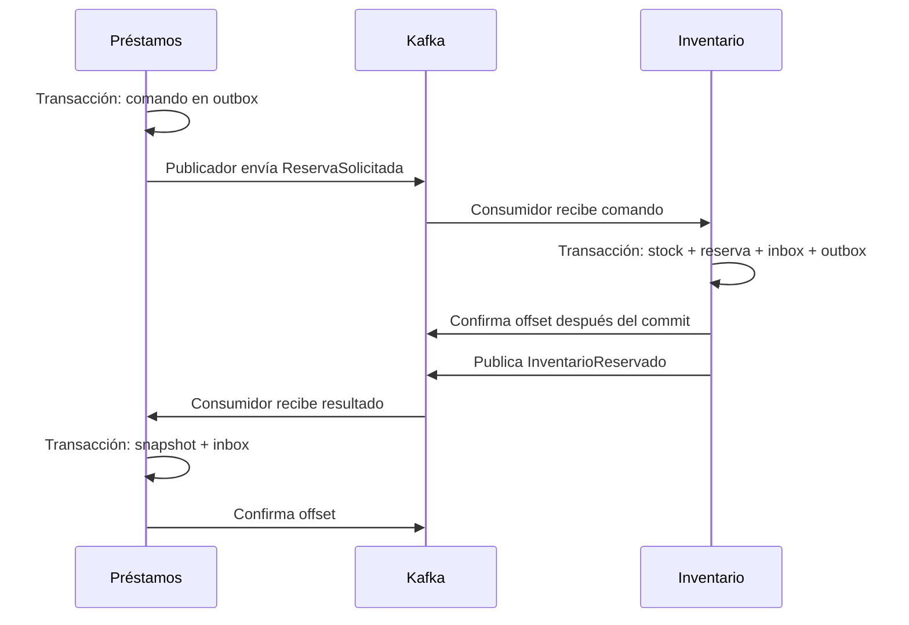

# Fase 6: Kafka entre Préstamos e Inventario

Esta fase conecta comandos y resultados reales. No aprueba créditos, no ejecuta un modelo y no expone una API pública de reservas. El flujo completo de financiación corresponde a la fase 9.

## Recorrido



En fase 6, Préstamos conserva una proyección del estado de inventario en `inventory_snapshots`. Esa tabla no representa una decisión crediticia ni reemplaza al Inventario autoritativo.

## Archivos principales

- `shared/messages.py`: validación contra los contratos de fase 1, creación del sobre y encolado.
- `shared/messaging_models.py`: tablas locales `outbox`, `inbox` y `message_failures`.
- `shared/messaging.py`: publicador, consumidor, confirmaciones, reintentos y DLQ.
- `services/inventario/app/messaging.py`: adaptación de comandos al dominio y barrido de vencimientos.
- `services/prestamos/app/messaging.py`: proyección de resultados, protegida contra revisiones antiguas.
- Migraciones `0003` en Inventario y `0002` en Préstamos.
- `shared/messaging_cli.py` y `scripts/kafka_ops.py`: herramientas locales del operador.
- `scripts/check_phase6.py`: pruebas de integración y fallos.

## Garantías y límites

Los cambios de stock, la marca inbox y el resultado outbox se guardan en la misma transacción PostgreSQL. El publicador marca un mensaje como enviado solo después de recibir confirmación del broker. Un reinicio entre confirmación y commit puede causar una publicación repetida: se conserva `event_id` y el consumidor deduplica. Si se repite el ID con otro contenido, el mensaje se rechaza por conflicto.

La entrega es **al menos una vez**, con efectos de negocio idempotentes. No existe una transacción global Kafka/PostgreSQL. Las claves son `prestamo_id`, con tres particiones por topic. El publicador usa idempotencia, `acks=all` y un envío en vuelo. Cada servicio tiene un publicador activo por base de datos, protegido con un bloqueo transaccional. Una salida pendiente bloquea las posteriores de ese servicio: se prioriza el orden sobre el rendimiento.

El consumidor desactiva commits y almacenamiento de offsets automáticos. Confirma cada mensaje después del commit local. Una partición con fallo se pausa; el bucle continúa haciendo poll y atendiendo otras particiones. Los callbacks de revocación descartan entregas pendientes en memoria; el nuevo propietario recupera desde el último offset confirmado y consulta los registros durables.

Los fallos de procesamiento se reintentan después de 5, 15 y 60 segundos (cuatro intentos totales). El contador y el instante del siguiente intento persisten en PostgreSQL. Un contrato inválido o conflicto de negocio permanente se envía directamente a DLQ. El fallo terminal y el mensaje DLQ se guardan juntos antes de avanzar el offset. Si la base de datos no permite registrar el fallo, el consumidor no confirma el mensaje.

Los topics DLQ conservan el sobre y los bytes originales en base64, incluso si no eran JSON. Las ACL existentes permiten a cada servicio producir y consumir solo sus topics y grupos. Las herramientas administrativas requieren acceso local a Docker; no están expuestas al navegador.

Inventario ejecuta un barrido cada dos segundos, hasta 50 reservas por transacción. El vencimiento devuelve stock y genera `ReservaExpirada` en la misma transacción. La consulta interna también usa esta operación. Las pruebas directas del dominio siguen siendo posibles, pero cualquier nueva ruta de negocio debe usar el adaptador que registra el evento.

Los trabajadores viven en el proceso de cada API, con un hilo consumidor y otro publicador; Inventario añade el barrido. Este despliegue académico usa un broker único sin alta disponibilidad. El número de hilos no implica procesos independientes ni aprobación de préstamos.

## Arranque

```powershell
python -m pip install -r requirements-bootstrap.txt
python scripts/bootstrap.py
docker compose up -d --build --wait --wait-timeout 300
```

Las migraciones se aplican antes de arrancar los trabajadores. Los datos y cuentas existentes se conservan. La pantalla **Inventario** permite consultar los efectos; esta fase se demuestra principalmente mediante pruebas y herramientas de operador.

## Pruebas

```powershell
python scripts/check_phase6.py
python scripts/check_phase6.py --faults
```

El segundo comando interrumpe temporalmente Kafka y reinicia servicios. Ambos conservan datos sintéticos de prueba; las existencias de prueba tienen UUID propios. No eliminan volúmenes. La prueba del contador de reintentos inyecta una excepción dentro de una transacción y verifica los intervalos persistidos sin esperar los 80 segundos completos.

Consultar `validacion-fase-6.md` para los resultados realmente ejecutados y sus límites.

## Inspección y diagnóstico

```powershell
python scripts/kafka_ops.py status --service inventario
python scripts/kafka_ops.py status --service prestamos
python scripts/kafka_ops.py lag --service inventario
python scripts/kafka_ops.py lag --service prestamos
docker compose logs --tail 80 inventario prestamos
```

`status` muestra pendientes, inbox y últimos fallos locales, incluyendo `failure_id`. `lag` consulta offsets del grupo frente al final del topic. Los logs incluyen event_id/correlation_id, no información financiera ni credenciales.

Para validar de nuevo un mensaje fallido sin ejecutar efectos:

```powershell
python scripts/kafka_ops.py replay --service inventario --failure-id UUID_DEL_FALLO
```

Para volver a encolarlo después de corregir la causa:

```powershell
python scripts/kafka_ops.py requeue --service inventario --failure-id UUID_DEL_FALLO
```

El reenvío utiliza las credenciales del productor original y conserva el event_id. Si los bytes originales no son válidos, se requiere `--replacement archivo_corregido.json`, con un event_id nuevo. Conservar correlation_id permite relacionar la corrección. Esta herramienta valida los contratos; no modifica offsets de grupos ni borra la evidencia de DLQ. Si el mensaje ya tuvo efecto, inbox impide repetirlo.

Referencia técnica: [confirmación manual de offsets con el cliente Python de Confluent](https://docs.confluent.io/kafka-clients/python/current/overview.html).
