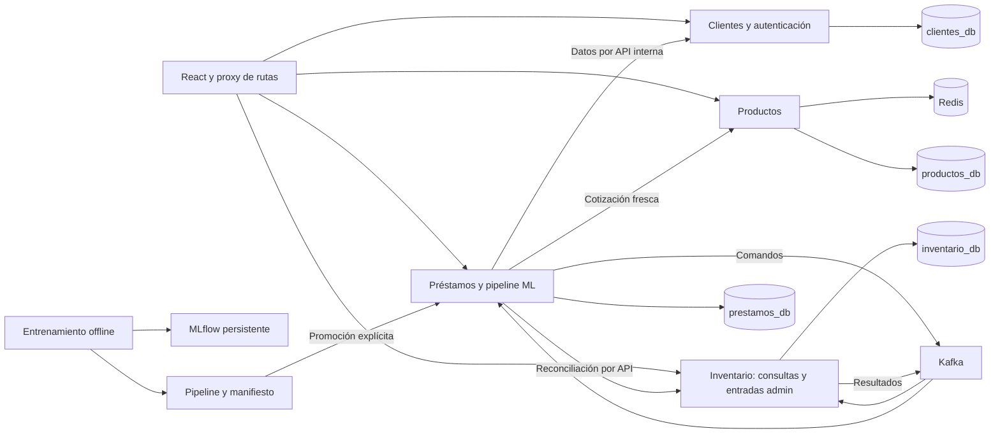
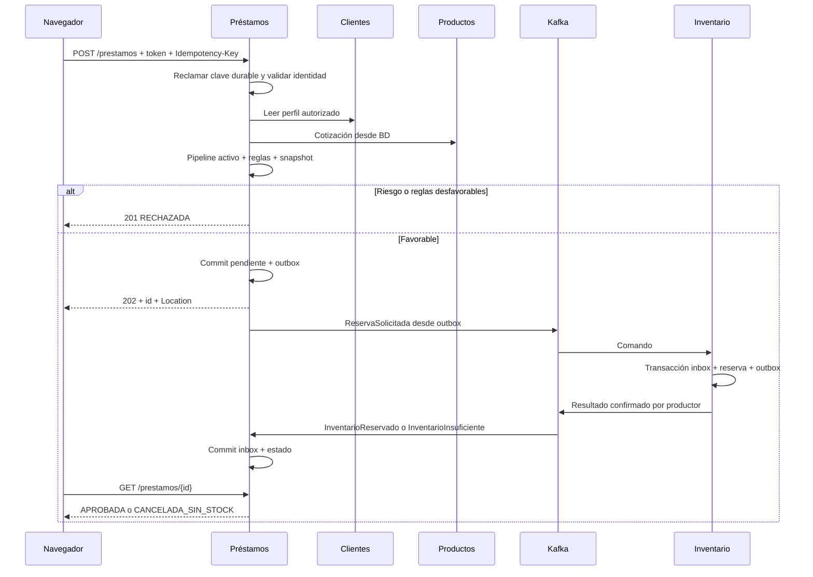

# Arquitectura y propiedad de datos

## Componentes

Una instancia PostgreSQL contiene bases independientes, además del almacenamiento de metadatos MLflow. Cada servicio tiene usuario sin permisos sobre bases ajenas. Redis no guarda deduplicación durable. El frontend accede a APIs, no a infraestructura ni artefactos ML. El proxy solo enruta; workers y publicadores pertenecen a sus servicios de negocio.

## Tablas y restricciones previstas

Todas las fechas se almacenan en UTC; UUID para claves internas, importes `NUMERIC(18,2)` y versiones enteras crecientes. Referencias entre servicios son UUID sin FK cruzada.

| Dueño | Tabla | Datos y restricciones esenciales |
|---|---|---|
| Productos | productos | id, nombre, categoría, precio > 0, activo, versión >= 1, timestamps |
| Productos | invalidaciones_cache | producto, versión, intentos, próxima ejecución; reintento tras fallo de Redis |
| Clientes | clientes | id, clave_externa única nullable, nombre, email, activo, ocho atributos financieros, versión |
| Clientes | usuarios | id, cliente_id único nullable, email único normalizado, password_hash, rol, activo; nunca devolver hash |
| Clientes | importaciones/errores_importacion | hash de archivo, totales, estado y errores por fila; no deducir idempotencia solo del hash |
| Préstamos | prestamos | id, propietario, producto, cantidad, plazo, estado, motivo, snapshot cotización/cliente/features/modelo, reserva y última revisión observada |
| Préstamos | historial_estados | préstamo, origen, destino, causa, event_id/request_id, fecha; append-only |
| Préstamos | idempotencia_http | UNIQUE(actor, operación, clave), hash canónico de cuerpo, recurso, respuesta final de creación, lease/estado de ejecución |
| Inventario | existencias | producto_id único, físico >= reservado >= 0; disponible = físico - reservado |
| Inventario | reservas | id, prestamo_id único, producto/cantidad (nullable solo en marca previa), estado, revisión, vence_en; índices para vencimiento |
| Inventario | movimientos | entrada/reserva/liberación/salida/vencimiento, cantidad, préstamo opcional, operación única, fecha |
| Inventario | idempotencia_http | misma estructura para entradas de stock, evita duplicarlas al reintentar |
| Préstamos e Inventario | outbox | event_id único, agregado, secuencia, topic, key, payload, intentos, enviado_en; escritura junto al efecto |
| Préstamos e Inventario | inbox | UNIQUE(consumer_group,event_id), hash de mensaje, procesado_en; escritura junto al efecto |
| Préstamos e Inventario | fallos_consumo | grupo/topic/partición/offset, intentos, causa, próxima ejecución, disposición; permite DLQ sin marcar negocio como aplicado |

No borrar reservas terminales, claves HTTP ni inbox durante el proyecto académico. Preservar outbox/historial para reconciliación más allá de la retención Kafka. Una réplica de un servicio no cambia su propiedad de datos.

## Secuencia principal

Entrega y cancelación siguen el mismo patrón: petición HTTP → transición pendiente y outbox → comando → transacción en Inventario → resultado → estado final. La API de reconciliación de Inventario es solo de lectura, no reemplaza el broker en el flujo normal.

## Reglas de cotización y características

Política académica v1: cantidad entera 1–100; plazo en 6/12/18/24/36; monto financiable COP 500.000–15.000.000 inclusive. Cantidad/plazo mal formados: 422. Monto derivado fuera de política o cliente/producto inactivo: préstamo RECHAZADA con motivo explícito, sin inventario. Son reglas del proyecto, no recomendaciones crediticias reales.

Monto = precio unitario vigente × cantidad. Tasa fija 0,018; cuota de anualidad redondeada a dos decimales con HALF_UP. Cotización: versión y precio al instante de lectura; no se promete bloquear futuras ediciones del producto. Catálogo cacheado puede atrasarse hasta TTL 60 s; la API interna de cotización omite Redis.

Ocho atributos de cliente: ingresos, obligaciones, empleo, antigüedad laboral, meses de historial, créditos previos, atrasos previos y porcentaje puntual. Junto a monto, plazo y cuota constituyen once predictores iniciales. Excluir IDs, etiqueta y tasa constante del estimador. Cuota redundante se conserva inicialmente como transformación útil y se justifica en el informe.

`porcentaje_pago_puntual = null` si y solo si créditos previos = 0. Empleo, antigüedad y meses de historial permiten null. Los valores decimales `6.0000` de meses en CSV se convierten a enteros solo si no tienen fracción. El resto de faltantes, categorías desconocidas, NaN/Infinity y rangos inválidos se rechazan. Los máximos observados no son límites universales: meses y conteos solo exigen no negativos.

ML: split 60/20/20 estratificado semilla 42, baseline + tres algoritmos y seis candidatos, AP validación como selección principal, desempate dentro de 0,005 por Brier y complejidad. Costos ficticios iniciales 5 para aprobar incumplidor y 1 para rechazar pagador; umbral fijado con validación antes de prueba. Preprocesamiento aprendido solo en entrenamiento. Artefacto y manifiesto versionados, promoción explícita y modelo cargado al inicio.

Las 200 solicitudes sirven para inferencia y paridad API; no contienen etiquetas ni catálogo. La importación adapta solo atributos de cliente, nunca usa su monto como precio de compra. Una segunda versión no se declara superior sin evidencia independiente.
