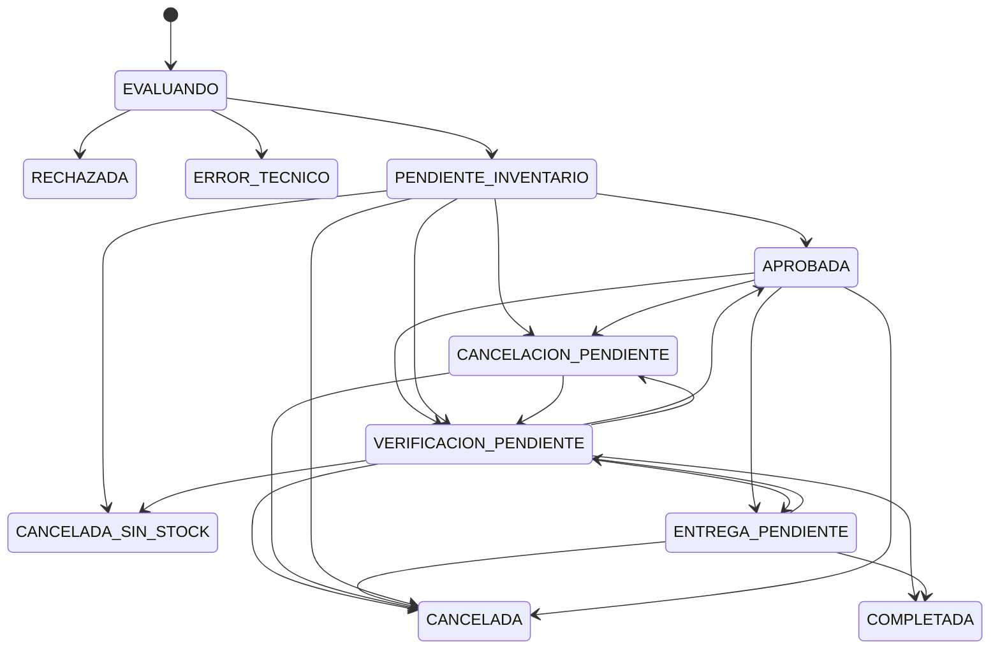
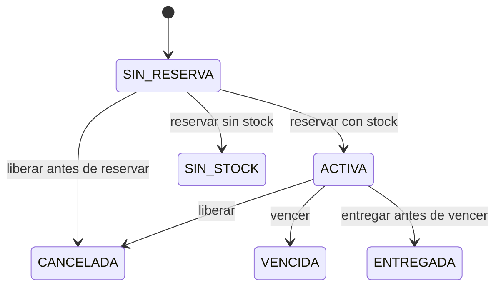

# Estados, invariantes y recuperación

Esta especificación es normativa para v1. Las tablas enumeran transiciones permitidas; las reglas de cierre al final cubren las combinaciones restantes. Todos los cambios usan bloqueo de fila o versión esperada, escriben historial y generan outbox en la misma transacción local.

## Invariantes

1. `fisico >= reservado >= 0`; disponible = físico − reservado. Reservar incrementa reservado; liberar/vencer lo disminuye; entregar disminuye ambos.
2. Una operación de reserva por préstamo, durable incluso si es cancelada antes de existir stock reservado.
3. Un efecto de negocio por operación aunque lleguen event_id distintos; inbox elimina además reentregas del mismo event_id.
4. APROBADA requiere evidencia de reserva vigente. COMPLETADA requiere EntregaConfirmada o snapshot autoritativo ENTREGADA de reconciliación. CANCELADA requiere confirmación de reserva no utilizable, no un timeout.
5. No reactivar préstamos terminales. Rechazo por riesgo/reglas no emite ReservaSolicitada.
6. No usar tiempo de llegada para ordenar revisiones. Cada resultado incluye reserva_id, estado_reserva y revision_reserva de Inventario, además de vence_en cuando aplique.

## Préstamo

Terminales: RECHAZADA, ERROR_TECNICO, CANCELADA_SIN_STOCK, CANCELADA, COMPLETADA. ERROR_TECNICO agrega una salida para evaluación fallida antes de cualquier reserva. VERIFICACION_PENDIENTE impide mostrar una aprobación utilizable cuando ya pasó el vencimiento pero aún falta confirmar el estado físico.

| Origen | Disparador y guarda | Destino / efecto |
|---|---|---|
| EVALUANDO | Cliente/producto inactivo, información incompleta, monto fuera de política o riesgo desfavorable | RECHAZADA con motivo; sin comando |
| EVALUANDO | Reglas favorables + pipeline válido | PENDIENTE_INVENTARIO + ReservaSolicitada |
| EVALUANDO | Fallo técnico | Mantener y reintentar; a los 5 min ERROR_TECNICO, sin comando |
| PENDIENTE_INVENTARIO | InventarioReservado, revisión aceptable y vence_en futura | APROBADA |
| PENDIENTE_INVENTARIO | InventarioInsuficiente | CANCELADA_SIN_STOCK |
| PENDIENTE_INVENTARIO o APROBADA | Cancelación HTTP autorizada | CANCELACION_PENDIENTE + LiberacionSolicitada |
| APROBADA | Entrega HTTP admin, antes de vence_en | ENTREGA_PENDIENTE + EntregaSolicitada |
| APROBADA o ENTREGA_PENDIENTE | Hora local alcanza vence_en sin resultado final | VERIFICACION_PENDIENTE; guardar acción pendiente, reconciliar |
| PENDIENTE_INVENTARIO | InventarioReservado ya vencido o 60 s sin respuesta | VERIFICACION_PENDIENTE; no aprobar |
| VERIFICACION_PENDIENTE | Snapshot ACTIVA vigente y sin acción pendiente | APROBADA |
| VERIFICACION_PENDIENTE | Snapshot ACTIVA vigente, entrega ya solicitada | ENTREGA_PENDIENTE; no generar segunda entrega |
| VERIFICACION_PENDIENTE | Cancelación HTTP, sin entrega previamente aceptada | CANCELACION_PENDIENTE + LiberacionSolicitada |
| VERIFICACION_PENDIENTE | Snapshot ACTIVA cuyo tiempo ya venció | Mantener; Inventario debe procesar vencimiento bajo bloqueo |
| PENDIENTE_INVENTARIO, APROBADA, ENTREGA_PENDIENTE o VERIFICACION_PENDIENTE | ReservaExpirada o snapshot VENCIDA | CANCELADA / RESERVA_VENCIDA |
| VERIFICACION_PENDIENTE | Snapshot SIN_STOCK | CANCELADA_SIN_STOCK |
| CANCELACION_PENDIENTE | ReservaLiberada, ReservaExpirada o snapshot CANCELADA/VENCIDA/SIN_STOCK | CANCELADA; motivo de usuario o vencimiento |
| CANCELACION_PENDIENTE | InventarioReservado, incluso tardío | Mantener; asegurar comando de liberación, nunca aprobar |
| CANCELACION_PENDIENTE | InventarioInsuficiente | CANCELADA; no hay reserva y existe marca terminal SIN_STOCK |
| ENTREGA_PENDIENTE o VERIFICACION_PENDIENTE con entrega aceptada | EntregaConfirmada o snapshot ENTREGADA | COMPLETADA |
| ENTREGA_PENDIENTE | EntregaRechazada con VENCIDA/CANCELADA/SIN_STOCK | CANCELADA con causa autoritativa |
| ENTREGA_PENDIENTE | EntregaRechazada con SIN_RESERVA | VERIFICACION_PENDIENTE, investigar orden; no inventar salida |
| VERIFICACION_PENDIENTE | Snapshot CANCELADA | CANCELADA |
| Cualquier estado de espera | Timeout, caída Kafka/BD o mensaje inválido | No inferir rechazo/stock; conservar estado y alertar |

Una lectura GET con APROBADA pero vencimiento pasado presenta VERIFICACION_PENDIENTE y `reserva_utilizable=false`, y programa reconciliación; el worker persiste la transición. No autorizar entrega basándose únicamente en el estado almacenado. Explicar en la UI que se está verificando la reserva.

HTTP cancelar/entregar: en EVALUANDO devolver 409; esperar decisión. Una entrega ya aceptada bloquea cancelación, incluyendo VERIFICACION_PENDIENTE con acción entrega. Cancelación ya aceptada bloquea entrega. Repetir la misma acción pendiente devuelve 202; repetir su resultado terminal propio devuelve 200; otras acciones sobre estados terminales devuelven 409. RECHAZADA/ERROR_TECNICO no tienen reservas que cancelar.

## Reserva en Inventario

Estado SIN_RESERVA representa ausencia de fila, no un registro; la revisión 0 se usa únicamente en resultados de operación que no encontraron reserva. Toda fila real tiene UUID de reserva y revisión >= 1.

| Estado | Comando/acción | Resultado y efecto |
|---|---|---|
| SIN_RESERVA | ReservaSolicitada, stock suficiente | Crear ACTIVA, reservar atómicamente, revisión 1, InventarioReservado |
| SIN_RESERVA | ReservaSolicitada, stock insuficiente | Crear SIN_STOCK, revisión 1, InventarioInsuficiente; no cambia stock |
| SIN_RESERVA | LiberacionSolicitada | Crear marca CANCELADA, revisión 1, ReservaLiberada; sin movimiento de stock |
| SIN_RESERVA | EntregaSolicitada | EntregaRechazada/SIN_RESERVA, reserva_id null, revisión 0; no crear salida |
| ACTIVA | ReservaSolicitada mismo producto/cantidad | No volver a reservar; responder snapshot ACTIVA si vigente |
| ACTIVA | LiberacionSolicitada antes de vencer | Liberar, CANCELADA, incrementar revisión, ReservaLiberada |
| ACTIVA | EntregaSolicitada antes de vencer | Descontar físico y reservado, ENTREGADA, incrementar revisión, EntregaConfirmada |
| ACTIVA | Barrido o comando observa vencimiento | Liberar, VENCIDA, incrementar revisión, ReservaExpirada; si era entrega emitir también EntregaRechazada |
| SIN_STOCK | ReservaSolicitada | InventarioInsuficiente, sin nueva evaluación de stock para este préstamo |
| SIN_STOCK | LiberacionSolicitada | ReservaLiberada con estado SIN_STOCK; no altera stock |
| CANCELADA | ReservaSolicitada o LiberacionSolicitada | ReservaLiberada, no reservar ni incrementar stock |
| VENCIDA | ReservaSolicitada o LiberacionSolicitada | ReservaExpirada, no reservar |
| SIN_STOCK, CANCELADA o VENCIDA | EntregaSolicitada | EntregaRechazada con estado y motivo terminal |
| ENTREGADA | EntregaSolicitada | EntregaConfirmada del mismo efecto, sin segunda salida |
| ENTREGADA | LiberacionSolicitada | LiberacionRechazada / YA_ENTREGADA; no devolver stock |
| ENTREGADA | ReservaSolicitada repetida | EntregaConfirmada del efecto existente, sin reservar |

Todo comando de reserva sobre una fila que ya tiene producto/cantidad debe coincidir con ellos; de lo contrario es conflicto de integridad a DLQ, sin cambio de stock. La marca CANCELADA previa no requiere producto/cantidad y bloquea cualquier reserva de ese préstamo.

## Duplicados, desorden y casos no enumerados

- Mismo event_id y mismo contenido: no repetir efecto; confirmar offset. Mismo event_id con otro contenido: conflicto a DLQ y alerta. Guardar hash además del id.
- Otro event_id para la misma operación: evaluar tabla de dominio. Emitir resultado si hace falta sin repetir movimiento.
- Préstamos ignora revisiones menores que la última aplicada. Misma revisión y mismo snapshot es un no-op, salvo que complete una acción pendiente compatible (p. ej. ReservaLiberada con SIN_STOCK). Misma revisión con snapshots contradictorios: DLQ y reconciliación.
- Usar reserva_id constante por préstamo; otra identidad para la misma reserva es conflicto. La revisión 0 no reemplaza una revisión conocida >= 1.
- LiberacionRechazada/ENTREGADA en CANCELACION_PENDIENTE es una contradicción que los guardas deben impedir: no declarar cancelada, pasar a VERIFICACION_PENDIENTE con alerta y resolver a COMPLETADA al confirmar salida autoritativa; auditar el incidente.
- ReservaLiberada inesperada en un estado no terminal pasa a VERIFICACION_PENDIENTE y confirma snapshot antes de cerrar CANCELADA. EntregaConfirmada inesperada también exige reconciliación; si Inventario confirma ENTREGADA, cerrar COMPLETADA y alertar acción no registrada.
- Estados terminales no cambian por mensajes. Si un resultado contradice su invariancia, registrar incidente y reconciliar sin reactivar. Para CANCELADA y una ACTIVA real inesperada, emitir liberación compensatoria durable.
- Evento de préstamo desconocido, schema_version no soportada o payload inválido: DLQ, sin inventar préstamo. Evento válido sin transición ni contradicción: registrar no-op y confirmar.
- Reconciliación usa GET interno de reserva e integra el snapshot mediante las mismas guardas; 404 no significa stock cero. En VERIFICACION_PENDIENTE sin fila, republicar el comando original con mismo event_id (si no procesado) o emitir operación idempotente según historial; no cambiar a final sin evidencia.

## Tiempos y orden de locks

Reserva 10 min desde el commit en Inventario; barrido cada 5 s. Reservar no usa `occurred_at` de un mensaje antiguo para fijar vencimiento. HTTP interno: timeout 2 s, dos reintentos de lecturas. Pendiente 60 s activa reconciliación; una caída no fija un plazo ficticio de stock. Polling navegador 2 s con backoff. Revisar outbox cada 1 s y reconciliar cada 5 s con backoff hasta 60 s.

Lock por préstamo/reserva para serializar comandos, seguido del registro de existencias; tomar siempre en ese orden. Para la primera reserva usar inserción única/lock de agregado que también serialice cancelación sin fila. Inbox, movimiento, reserva y outbox se confirman juntos. Vencimiento y entrega usan el mismo lock y comparan la hora de BD; solo uno puede consumir la reserva.
