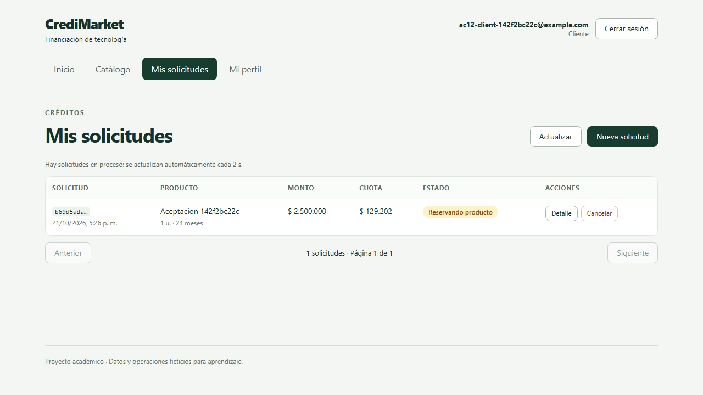
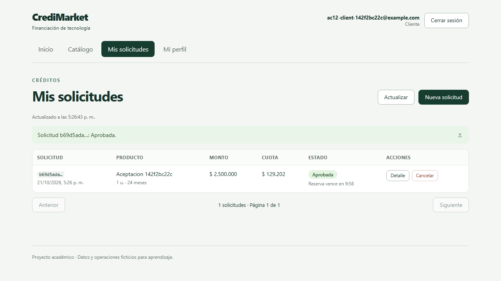
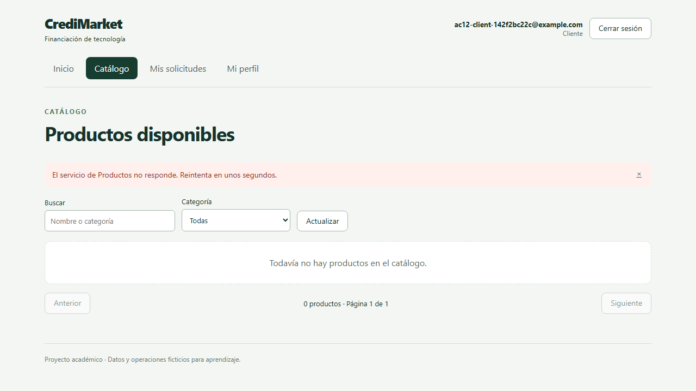

# Verificación de fase 12

Estado: **16 casos de aceptación aprobados** y todas las suites requeridas terminadas con código 0.

Ejecución: `20261021T220337-78a0d4`. Finalizada: `2026-10-21T22:34:48.959945+00:00`. Commit base: `cd0f87b2144eb3e5a4ad57f1d8ab84e0c756e9ee`.

Se probó el código de trabajo del repositorio, incluidas las correcciones locales; los logs conservan el hash del script ejecutado. Los datos sintéticos se conservan y los servicios se restauraron.

[Resultados estructurados](evidencias/fase12-20261021T220337-78a0d4/results.json) y [huellas del código, contratos, modelos y fuentes al cierre](evidencias/fase12-20261021T220337-78a0d4/workspace_hashes.json). Cada caso exige todas las suites enlazadas:

| Caso | Resultado | Evidencia |
|---|---|---|
| AC01 | PASS | [prestamos](evidencias/fase12-20261021T220337-78a0d4/prestamos.log) |
| AC02 | PASS | [prestamos](evidencias/fase12-20261021T220337-78a0d4/prestamos.log) |
| AC03 | PASS | [prestamos](evidencias/fase12-20261021T220337-78a0d4/prestamos.log) |
| AC04 | PASS | [inventario](evidencias/fase12-20261021T220337-78a0d4/inventario.log), [prestamos](evidencias/fase12-20261021T220337-78a0d4/prestamos.log) |
| AC05 | PASS | [inventario](evidencias/fase12-20261021T220337-78a0d4/inventario.log), [prestamos](evidencias/fase12-20261021T220337-78a0d4/prestamos.log), [kafka](evidencias/fase12-20261021T220337-78a0d4/kafka.log), [faults](evidencias/fase12-20261021T220337-78a0d4/faults.log) |
| AC06 | PASS | [kafka](evidencias/fase12-20261021T220337-78a0d4/kafka.log), [faults](evidencias/fase12-20261021T220337-78a0d4/faults.log) |
| AC07 | PASS | [inventario](evidencias/fase12-20261021T220337-78a0d4/inventario.log), [prestamos](evidencias/fase12-20261021T220337-78a0d4/prestamos.log), [faults](evidencias/fase12-20261021T220337-78a0d4/faults.log) |
| AC08 | PASS | [productos](evidencias/fase12-20261021T220337-78a0d4/productos.log), [redis](evidencias/fase12-20261021T220337-78a0d4/redis.log) |
| AC09 | PASS | [productos](evidencias/fase12-20261021T220337-78a0d4/productos.log), [prestamos](evidencias/fase12-20261021T220337-78a0d4/prestamos.log) |
| AC10 | PASS | [modelo](evidencias/fase12-20261021T220337-78a0d4/modelo.log) |
| AC11 | PASS | [mlops](evidencias/fase12-20261021T220337-78a0d4/mlops.log) |
| AC12 | PASS | [clientes](evidencias/fase12-20261021T220337-78a0d4/clientes.log) |
| AC13 | PASS | [clientes](evidencias/fase12-20261021T220337-78a0d4/clientes.log), [prestamos](evidencias/fase12-20261021T220337-78a0d4/prestamos.log) |
| AC14 | PASS | [frontend](evidencias/fase12-20261021T220337-78a0d4/frontend.log) |
| AC15 | PASS | [pending_ui](evidencias/fase12-20261021T220337-78a0d4/pending_ui.log) |
| AC16 | PASS | [clientes](evidencias/fase12-20261021T220337-78a0d4/clientes.log), [modelo](evidencias/fase12-20261021T220337-78a0d4/modelo.log), [frontend](evidencias/fase12-20261021T220337-78a0d4/frontend.log), [pending_ui](evidencias/fase12-20261021T220337-78a0d4/pending_ui.log) |

## Redis: medición observada

60 consultas HTTP secuenciales por escenario, por loopback dentro de Productos. La preparación de caché se excluye del tiempo. Los encabezados X-Cache identifican el origen.

| Escenario | p50 (ms) | p95 (ms) | HIT | MISS | BYPASS |
|---|---:|---:|---:|---:|---:|
| Miss forzado | 5.968 | 7.322 | 0 | 60 | 0 |
| Caché caliente | 7.085 | 10.082 | 60 | 0 | 0 |
| Redis detenido | 408.963 | 412.752 | 0 | 0 | 60 |

TTL inicial observado: 56 s; espera hasta expiración: 56.91 s, sin forzar ni reducir TTL.

En esta carga local pequeña la caché caliente no resultó más rápida que el miss. No se demuestra una mejora de latencia con este ensayo; no se oculta ese resultado ni se extrapola a otras cargas.

Se verificaron invalidación al editar precio, escritura con Redis detenido y registro durable de invalidación pendiente. Tras recuperarlo se leyó el precio nuevo.

[Mediciones completas](evidencias/fase12-20261021T220337-78a0d4/redis_metrics.json). No se extrapolan a capacidad máxima, concurrencia de producción ni SLA.

## Recursos del entorno

VM Docker: 12 CPU, 16579244032 bytes de memoria asignada, Docker 29.2.1. Muestras: 24.

| Contenedor | Máximo CPU observado (%) | Máximo memoria observado (%) |
|---|---:|---:|
| credimarket-clientes-1 | 48.73 | 0.61 |
| credimarket-frontend-1 | 2.96 | 0.07 |
| credimarket-inventario-1 | 25.33 | 0.41 |
| credimarket-kafka-1 | 179.5 | 3.07 |
| credimarket-mlflow-1 | 40.15 | 4.47 |
| credimarket-postgres-1 | 3.74 | 0.52 |
| credimarket-prestamos-1 | 23.38 | 0.97 |
| credimarket-productos-1 | 90.7 | 0.72 |
| credimarket-redis-1 | 4.38 | 0.03 |

[Muestras originales](evidencias/fase12-20261021T220337-78a0d4/resources.json). Son máximos de muestras durante el microbenchmark, no máximos continuos ni memoria física total del equipo.

## Fallos y navegador

[Caídas en fronteras de commit](evidencias/fase12-20261021T220337-78a0d4/crash_boundaries.json): trabajadores aislados terminaron después del ACK de Kafka y antes de confirmar outbox, y después del commit de Inventario y antes de confirmar offset. Se comprobó recuperación y un solo movimiento de reserva.

[Pendiente y recuperación reales](evidencias/fase12-20261021T220337-78a0d4/pending_ui.json): Inventario detenido, aprobación por polling al recuperarlo, formulario inválido sin envío, JWT vencido y Productos realmente detenido.

## Correcciones y procedencia de MLflow

Se detectó que el volumen local de MLflow no contenía las ejecuciones v1 incorporadas por Git en otro equipo. Se reprodujeron los siete modelos sobre train/validación y se verificó coincidencia con el reporte original. El conjunto test no se reevaluó; sus métricas se importaron con procedencia explícita y prefijo imported_test_.

[Mapa de ejecuciones originales a reproducciones locales](evidencias/fase12-20261021T220337-78a0d4/mlflow_reproduction.json). Se mantuvieron el artefacto, run de origen y evaluación histórica de los préstamos.

Se añadieron X-Cache para medir HIT/MISS/BYPASS y logs de asignación/revocación de particiones. No se agregaron interruptores de fallo a producción.

El primer ensayo Redis detectó bloqueo por DNS; el segundo confirmó esperas adicionales por los tres reintentos internos del cliente. Se corrigieron resolución asíncrona y política de cero reintentos para la caché opcional. Se repitieron Productos y Redis antes del cierre; los intentos fallidos se conservan como logs de intentos en la misma carpeta.

## Límites

Kafka es un broker único sin alta disponibilidad. El benchmark es local y secuencial; los fallos no cubren todas las particiones de red o condiciones del sistema operativo. Las invalidaciones fallidas se registran, pero no hay un trabajador automático de reintentos de esa tabla. Las cotizaciones internas usan PostgreSQL. La entrega desde un clon limpio y la sustentación corresponden a fase 13.
